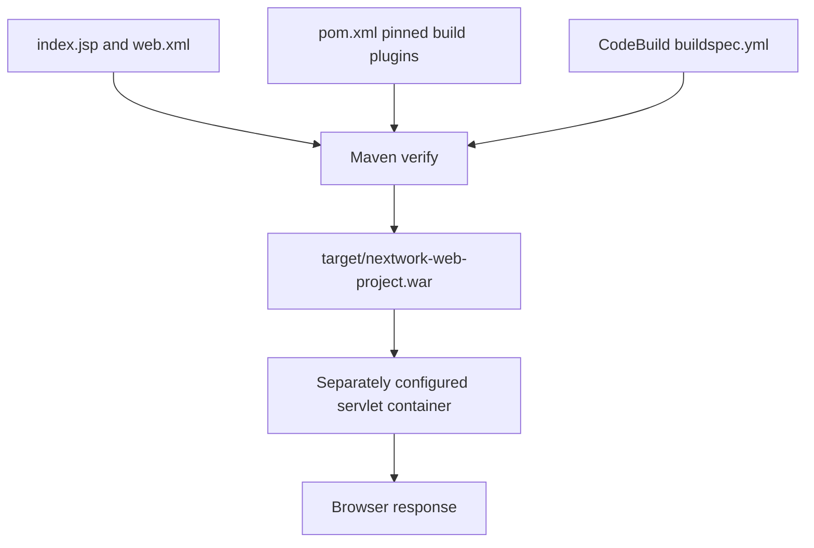
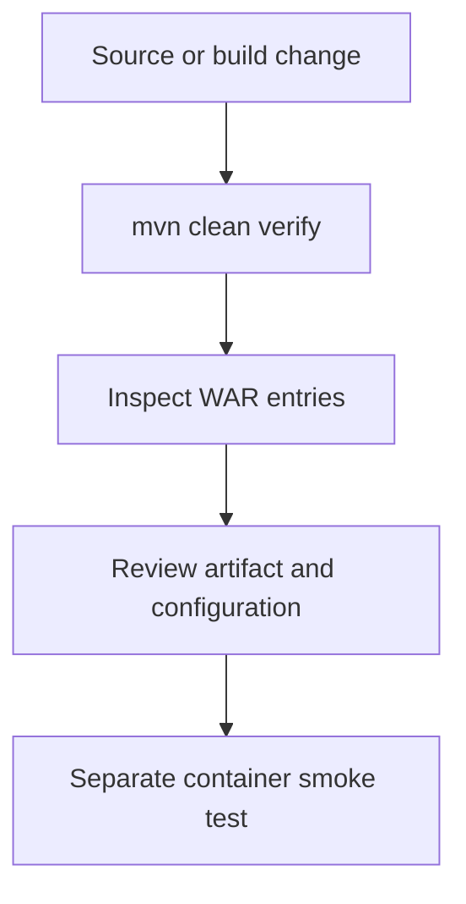

# NextWork web sample: architecture and maintenance

Reviewed 11 November 2026 against master `a536ae778a87a6c1ca0cf8ff4ffe29def8a28d1a`. This is a small guided Java web learning sample, maintained with AI assistance. The repository contains one JSP, a web descriptor and Maven/CodeBuild configuration. It does not contain an API, database, authentication layer or provisioned AWS infrastructure.

## Build and runtime boundaries

`src/main/webapp/index.jsp` contains static learning messages, not a diagnostic health endpoint. `WEB-INF/web.xml` is packaged with it. The WAR can be built without AWS credentials. Running it requires a compatible JSP/servlet container configured separately; producing the archive does not verify deployment.

## Build repair

The original CodeBuild file requested a token for one hardcoded account, while the Maven mirror URL contained a different account identifier. This made even a public sample depend on an account-specific private service. The default build now uses public Maven resolution with Java 17 and one `clean verify` command. Compiler and WAR plugin versions are explicit, avoiding the legacy WAR plugin inherited from Maven's defaults.

`settings.xml` is optional. Use it only with both `CODEARTIFACT_MAVEN_URL` and `CODEARTIFACT_AUTH_TOKEN` configured in your own environment. Never commit token values. A mirror must provide the required upstream dependencies; this configuration does not create that upstream or an AWS account.

## Verification and routine work

With JDK 17+ and Maven 3.9.x installed, run `mvn --batch-mode --no-transfer-progress clean verify`. Check `jar tf target/nextwork-web-project.war` contains `index.jsp` and `WEB-INF/web.xml`. The GitHub workflow builds on JDK 17 and checks both entries without deploying. There are no application unit tests; artifact validation is not a functional servlet test.

For a release, additionally start the selected container locally, request the page, check status/content type and review logs. Keep container version and runtime configuration documented when that runtime is added. Remove any credential helper that writes plaintext passwords; the historical JSP messages are not an instruction to store secrets.

## Scale and maintainability limits

The current page is stateless and has no dynamic data, so its primary capacity constraints belong to the chosen servlet host and asset delivery. No load test or availability target exists. Introduce health/readiness routes, structured error logs, resource limits and reproducible container configuration before scaling replicas. If sessions or uploads are later added, move state out of process before horizontal scaling. Avoid adding a database or queue until the application requires one. Pin and regularly review build dependencies, retain the last verified WAR for rollback, and test runtime compatibility separately from packaging.

References: [build configuration](../pom.xml), [buildspec](../buildspec.yml), [optional settings](../settings.xml), [CI](../.github/workflows/build.yml).

